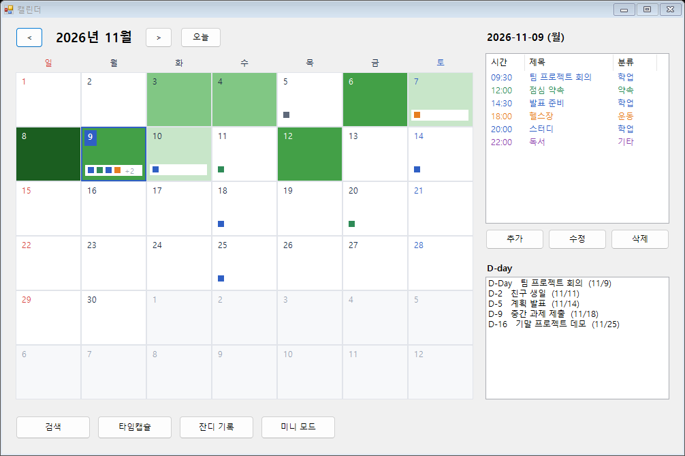
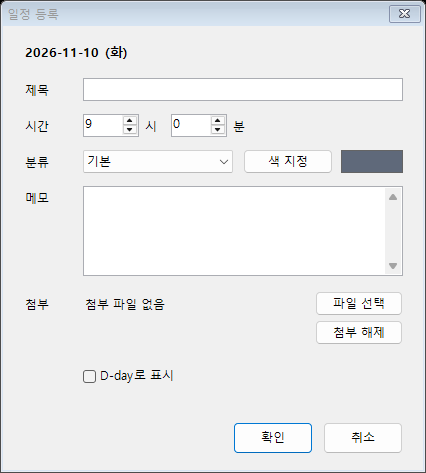
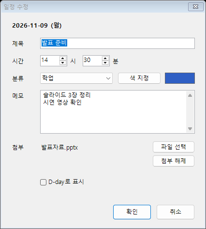
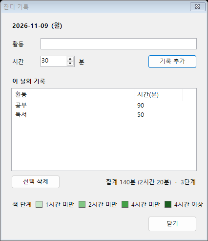

# 구현 화면

개발 담당(`ChildrenAon`)이 구현한 부분을 **실제로 실행해서 찍은 화면**입니다. 일정 제목, 시간, 잔디 기록은 화면을 보여 주려고 넣은 **예시 데이터**입니다.

- 구현한 기능: 필수 3개, 추가 기능 중 시간/분 설정·파일 첨부, 확장 중 카테고리 색·D-day·저장·불러오기·잔디 심기
- 다른 팀원이 만들 부분(타임캡슐, 키워드 검색, 미니 위젯)은 버튼과 빈 창만 연결되어 있고 아직 내용이 없습니다.
- 기능별 진행 상태는 [기능명세.md](기능명세.md), 설계는 [설계.md](설계.md)를 보세요.

## 1. 메인 화면 (달력)

| 화면의 어느 부분 | 보이는 것 | 기능 구분 |
|---|---|---|
| 맨 위 | 년/월, `<` `>` 이전·다음 달, `오늘` 버튼 | 필수 (달력 틀) |
| 파란 바탕의 날짜 숫자 | 오늘 날짜 표시 (그림에서는 9일) | 필수 (오늘 날짜 표시) |
| 파란 테두리 칸 | 내가 고른 날짜 | 필수 |
| 칸 아래의 작은 네모 점 | 그날의 일정. 점 색은 일정의 카테고리 색, 4개를 넘으면 `+2`처럼 표시 | 필수 + 확장 (카테고리 색) |
| 초록색 칸 바탕 | 잔디. 그날 활동 시간이 길수록 진한 초록 (4단계) | 확장 (잔디 심기) |
| 오른쪽 위 | 고른 날짜의 일정 목록과 [추가] [수정] [삭제] 버튼 | 필수 (일정 등록·수정·삭제) |
| 오른쪽 아래 | 오늘 이후의 D-day 일정 (`D-2  친구 생일  (11/11)`) | 확장 (D-day) |
| 맨 아래 | [잔디 기록] 버튼은 구현됨, [검색] [타임캡슐] [미니 모드]는 창만 연결됨 | 확장·추가 |

**조작법**

- 날짜 칸을 **한 번** 누르면 그 날짜가 선택되고, **두 번** 누르면 그 날짜에 일정을 추가하는 창이 열립니다.
- 다른 달의 연한 회색 날짜를 누르면 그 달로 이동합니다.
- 일정은 추가·수정·삭제할 때마다 자동으로 저장되고, 프로그램을 다시 실행하면 불러옵니다.

## 2. 일정 등록·수정 창

[추가] 또는 칸 더블클릭으로 **등록** 창이, 목록에서 일정을 골라 [수정]을 누르면 **수정** 창이 열립니다.

| 일정 등록 | 일정 수정 |
|---|---|
|  |  |

| 입력칸 | 설명 | 기능 구분 |
|---|---|---|
| 제목, 메모 | 제목은 꼭 입력해야 합니다 (비우면 안내 상자가 뜹니다) | 필수 |
| 시간 | 시와 분을 숫자 상자로 지정 | 추가 (시간/분 설정) |
| 첨부 | [파일 선택]으로 파일을 고르고 [첨부 해제]로 뺍니다. 파일 자체는 복사하지 않고 경로만 저장합니다 | 추가 (파일 첨부) |
| 분류, [색 지정] | 카테고리를 고르고, [색 지정]으로 그 카테고리의 색을 바꿉니다. 오른쪽 네모가 현재 색입니다 | 확장 (카테고리 색) |
| D-day로 표시 | 체크하면 메인 화면의 D-day 목록에 나옵니다 | 확장 (D-day) |

## 3. 잔디 기록 창

메인 화면의 [잔디 기록]을 누르면 열립니다. 달력에서 고른 날짜에 활동과 시간(분)을 기록합니다.

- 활동 이름과 시간을 입력하고 [기록 추가]를 누르면 목록에 쌓이고, 뒤에 보이는 달력 칸 색이 바로 바뀝니다.
- 목록에서 기록을 골라 [선택 삭제]로 지울 수 있습니다.
- 아래의 "색 단계"는 달력에 칠해지는 색과 같습니다.

| 그날 활동 시간 합계 | 단계 |
|---|---|
| 1시간 미만 | 1단계 (가장 연한 초록) |
| 1시간 이상 2시간 미만 | 2단계 |
| 2시간 이상 4시간 미만 | 3단계 |
| 4시간 이상 | 4단계 (가장 진한 초록, 날짜 글자는 흰색) |

---

화면은 Windows에서 Visual Studio 2022로 빌드한 프로그램을 실제로 띄워서 찍었습니다. 화면 배율이나 글꼴 설정에 따라 실제 모습은 조금 다를 수 있습니다.
